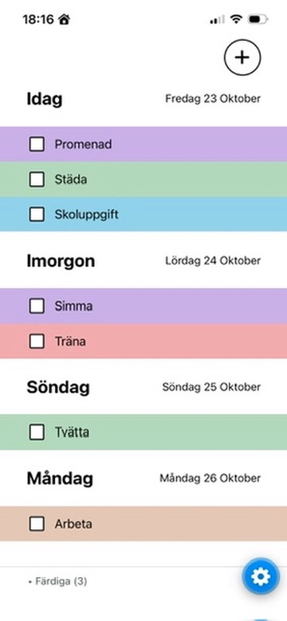
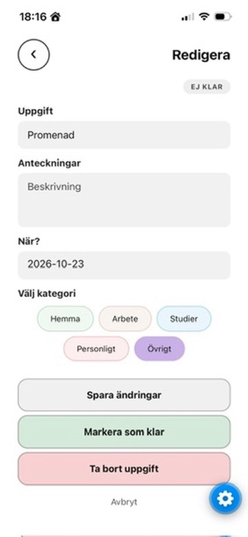

# Todo App

A todo app built with React Native, Expo and TypeScript.

## Screenshots

<p align="center">
  
  
  
</p>

## Features

- Add, edit and delete todos
- Mark todos as completed
- Organize todos by category
- Add descriptions
- Set due dates using a date picker

## Tech Stack

- React Native
- Expo
- TypeScript
- AsyncStorage for local storage
- Date and time picker with past dates disabled

## Getting Started

### Install dependencies

```bash
npm install
```

### Start the app

```bash
npx expo start
```

## Future Improvements

- Local storage
- Custom categories and filtering
- Statistics and settings
- Drag-and-drop reordering
- Accessibility improvements
- Scheduling and time selection
